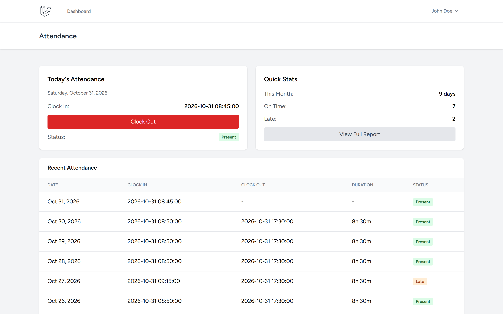
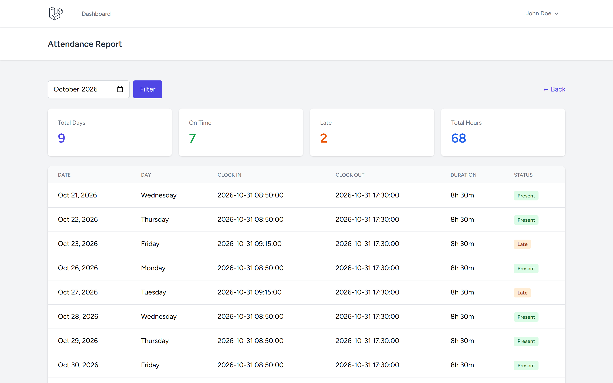
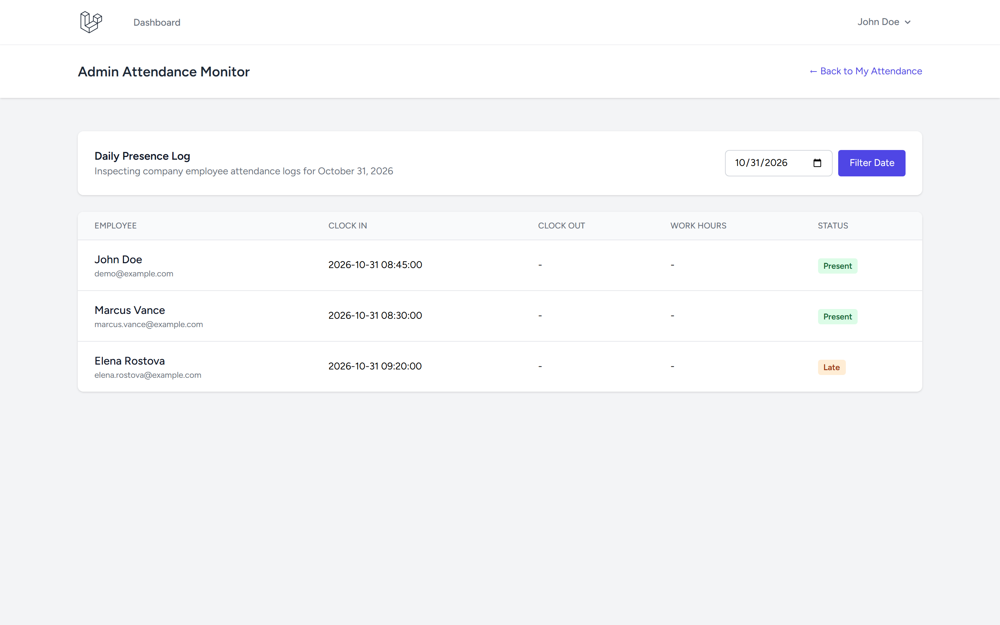
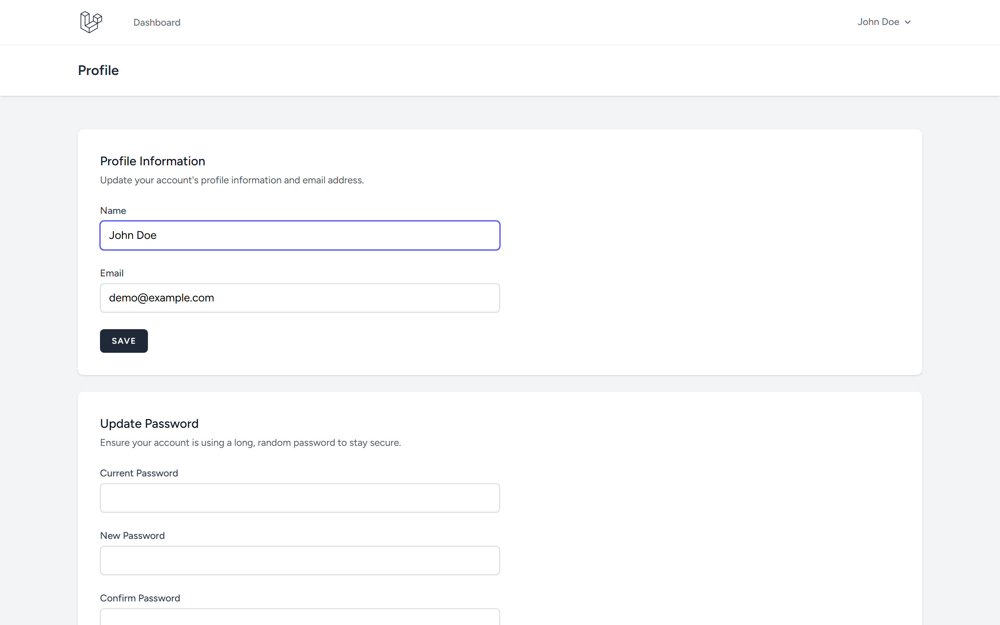

# Attendance App - Laravel

Employee attendance tracking with clock-in/out, reports, and admin dashboard.

Repository: https://github.com/0xyz-exe/attendance-app-laravel

## Screenshots

| Tampilan | Preview |
|---|---|
| **Dasbor Presensi Harian & Tombol Clock In/Out**<br>Panel pencatatan kehadiran mandiri dengan waktu masuk terkini, tombol clock out, ringkasan status on time/late bulanan, dan tabel log presensi |  |
| **Laporan & Rekapitulasi Presensi Bulanan**<br>Halaman laporan presensi bulanan dengan metrik total hari kerja, jumlah tepat waktu, keterlambatan, total akumulasi jam kerja, dan filter bulan |  |
| **Monitor Kehadiran Karyawan (Admin Panel)**<br>Panel pemantauan presensi harian seluruh karyawan perusahaan dengan log jam masuk/keluar, durasi kerja, dan indikator status kehadiran |  |
| **Pengaturan Profil Karyawan & Akun**<br>Pusat pengelolaan identitas profil pengguna dan pengaturan keamanan kata sandi akun |  |

## Features

- ✅ Clock-in and clock-out
- ✅ Automatic duration calculation
- ✅ Late detection (after 9:00 AM)
- ✅ Daily attendance view
- ✅ Monthly reports with statistics
- ✅ Attendance history
- ✅ Prevent duplicate clock-in
- ✅ Server-side timestamps
- ✅ User-specific attendance tracking
- ✅ Admin dashboard (all employees)
- ✅ CSV export ready
- ✅ Authentication (Breeze)

## Tech Stack

- Laravel 13.38.0
- Laravel Breeze 2.4
- PHP 8.5.0
- SQLite
- Tailwind CSS

## Installation

```bash
git clone https://github.com/0xyz-exe/attendance-app-laravel.git
cd attendance-app-laravel
composer install
npm install
cp .env.example .env
php artisan key:generate
touch database/database.sqlite
php artisan migrate --seed
npm run build
php artisan serve
```

## Demo Account

- Email: demo@example.com
- Password: password

## Database Schema

**attendances:**
- id, user_id, date
- clock_in, clock_out (time)
- duration_minutes (calculated)
- status (present/late/absent)
- notes, created_at, updated_at
- Unique constraint: user_id + date

## Features Detail

### Clock In/Out
- One clock-in per day per user
- Automatic timestamp capture
- Late status if clock-in after 9:00 AM
- Duration auto-calculated on clock-out
- Cannot clock out without clock-in

### Reports
- Monthly attendance summary
- Total days, on-time, late counts
- Total hours worked
- Filterable by month
- Export-ready data structure

### Security
- Server-side time validation
- Duplicate prevention via unique constraint
- User can only view own attendance
- Admin role for viewing all employees
- CSRF protection

## Routes

**User:**
- `/` - Attendance dashboard
- `POST /clock-in` - Clock in
- `POST /clock-out` - Clock out
- `/report` - Monthly report

**Admin:**
- `/admin` - All employees attendance

## Limitations

Browser-based location verification not included (requires separate geolocation service).
Timezone handling assumes server timezone. Configure APP_TIMEZONE in .env for multi-timezone support.

## Repository

https://github.com/0xyz-exe/attendance-app-laravel
